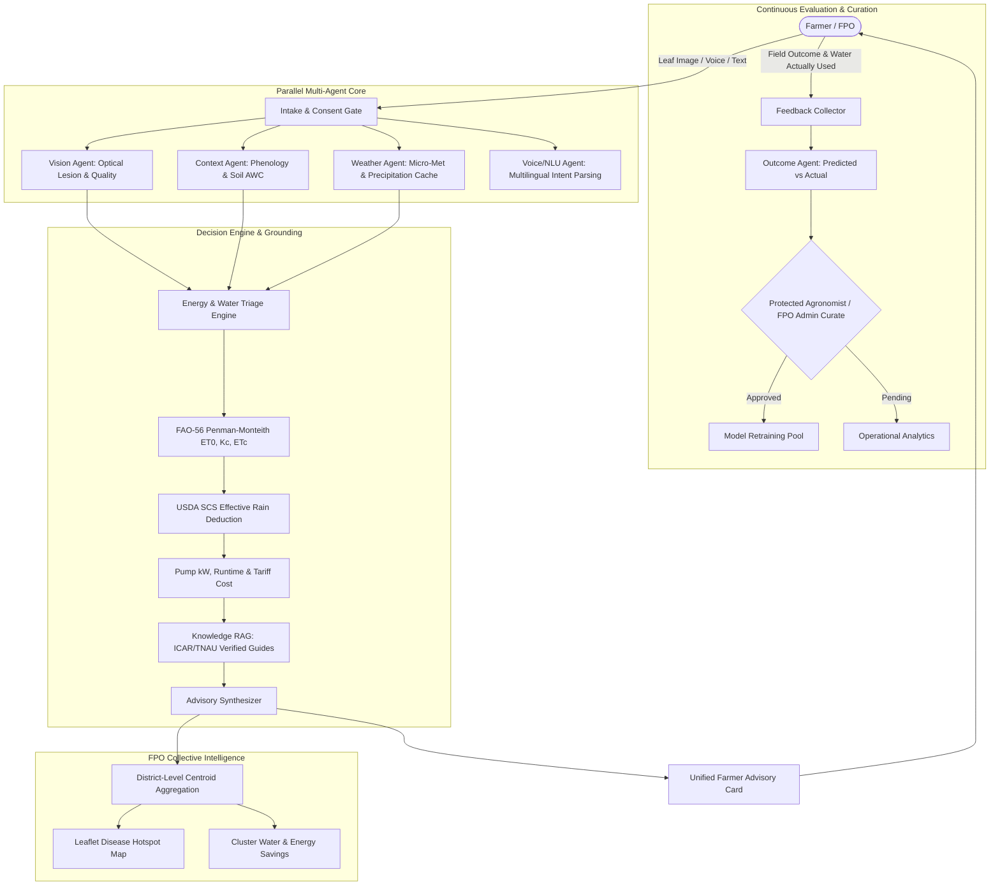

# AgriEdge
### Farmer-Owned Intelligence for Water, Energy & Crop Productivity

> **Primary Tagline:** *"Save Water. Save Energy. Grow Smarter."*  
> **Secondary Tagline:** *"AI-powered agricultural intelligence in the farmer's own language."*  
> **Core Philosophy:** *"Replace expensive physical sensors with software intelligence wherever possible."*

---

## 🌾 Project Overview

AgriEdge is an agro-technological decision platform built for smallholder farmers and Farmer Producer Organizations (FPOs). 

Most agricultural AI products stop at: *"Here is your leaf disease."*  
AgriEdge unites crop health diagnostics, meteorological precipitation forecasts, FAO-56 Penman-Monteith evapotranspiration modelling, pump energy consumption calculations, and verified extension agronomy into a single actionable decision:

- **What is happening to my crop?** (Foliar disease, severity %, and affected area)
- **What does the weather say?** (24h–48h rain forecast & waterlogging hazards)
- **Do I need to water?** (FAO-56 Penman-Monteith ET0, Kc, and effective rain deduction)
- **How much water and pump energy will that save?** (Pumping runtime, kWh, and cost)
- **What should I do next?** (Verified ICAR and TNAU agronomic treatments)
- **What happened when I followed the advice?** (Closed-loop feedback & Outcome Agent evaluation)

---

## 📋 System Truth & Capability Matrix: What is Real, Simulated, and Not Built

| Module / Capability | Status | True System Behavior & Implementation Details |
| :--- | :--- | :--- |
| **FAO-56 Penman-Monteith ET Engine** | **REAL** | Deterministic agronomic physics engine implementing FAO-56 Equation 6 ($ET_0$), growth-stage crop coefficient curves ($K_c$), and crop evapotranspiration ($ET_c$). |
| **Pump Power & Energy Model** | **REAL** | Mathematical model calculating pump power ($\text{kW} = \text{HP} \times 0.7457$), runtime hours from gross irrigation volume and pump discharge rate, electric kWh, electricity tariff cost, and diesel fuel consumption. |
| **Effective Precipitation Deduction ($P_e$)** | **REAL** | USDA Soil Conservation Service (SCS) method deducting effective rainfall from gross irrigation requirements. |
| **Leaf Quality Assessment (Blur & Lighting)** | **REAL** | Computer vision preprocessing computing Laplacian edge variance blur detection, luminance thresholding, and resolution minimums. |
| **Vision Crop Classification** | **REAL / HEURISTIC FALLBACK** | Optical analysis using multimodal AI when `GEMINI_API_KEY` is configured. When unconfigured, uses honest color/aspect-ratio heuristics capped strictly at 0.60 confidence, requires agronomist verification (`requires_agronomist_verification=true`), and displays a "Heuristic mode (no AI key)" badge in the UI. No filename-based classification exists in the production path. |
| **FPO Dashboard & Aggregation** | **REAL / DEMO GATED** | Computes KPIs aggregated directly from SQLite/PostgreSQL database tables (`FarmerProfile`, `Farm`, `Crop`, `Advisory`, `Feedback`). When database is empty, returns zeros and an empty-state message. Seeded demonstration data is gated behind `DEMO_DATA=true` or `?demo=true` and clearly renders a "Demo data" badge in the UI. Disease hotspots are aggregated strictly to district-level centroids from actual `Advisory.disease_detected` records. |
| **Weather Forecast & Observations** | **REAL / ESTIMATED FALLBACK** | OpenWeatherMap API integration with TTL caching when API key is set. When key is absent, provides a transparently labeled regional agro-meteorological estimation fallback. |
| **APMC Market Pricing** | **REAL / ESTIMATED FALLBACK** | Agmarknet / data.gov.in integration when API credentials are provided. When unconfigured, displays estimated regional historical benchmarks labeled as non-live. |
| **Cache Tier (Weather & Market)** | **REAL (Dual-Tier)** | Dual-tier cache powered by `redis-py` with automated graceful fallback to in-memory TTL dictionary. `/health` honestly inspects and reports the active backend (`redis` vs `memory_fallback`). |
| **Scenario Simulator** | **SIMULATED** | Deterministic what-if scenario simulations utilizing existing FAO-56 and energy engines: heatwave stress ($ET_0 +20\%$), 7-day drought ($0\text{ mm}$ rain), power outage (diesel pump fallback), and solar pump conversion (zero electric tariff). |
| **DPDP Digital Consent** | **REAL** | Digital Personal Data Protection (DPDP) compliance: consent checkbox at registration, timestamped consent version stored on the `User` model, dedicated `/privacy` policy page, and 403 Forbidden enforcement blocking image upload until consent is recorded. |
| **Feedback Curation for Retraining** | **REAL** | Length heuristics removed. `curated_for_retraining` defaults to `False` on all submissions. Curation is only granted via protected `PATCH /feedback/{id}/curate` restricted to authenticated `AGRONOMIST` and `FPO_ADMIN` roles. |
| **Supported Languages** | **REAL (en, hi, ta)** | Localized UI translations and voice intent parsing for English (`en`), Hindi (`hi`), and Tamil (`ta`). Other languages (`te`, `mr`, `bn`, `kn`) are not built and have been removed from options. |
| **WhatsApp / IVR Telephony** | **NOT BUILT** | No telephony, SMS gateway, or WhatsApp Business API integrations are connected. Removed from claims. |
| **NDVI / Satellite Telemetry** | **NOT BUILT** | Foliar diagnostics rely purely on ground-level leaf photographs. No satellite or remote sensing telemetry is implemented. |
| **AWS S3 Cloud Storage** | **NOT BUILT** | Image processing occurs in-memory via Pillow BytesIO and local storage; no AWS S3 buckets are utilized. |
| **MLflow Experiment Tracking** | **NOT BUILT** | Evaluation records are persisted in local SQL database tables; no external MLflow tracking server is configured. |

---

## 🏗 System Architecture



---

## ⚡ Key Technical Features

1. **FAO-56 Penman-Monteith Computational Engine:** Deterministic calculation of reference evapotranspiration ($ET_0$), growth stage coefficients ($K_c$), crop evapotranspiration ($ET_c$), and USDA SCS effective precipitation deduction ($P_e$).
2. **Pump Power & Energy Optimization:** Accurate kilowatt calculations based on pump horsepower, runtime hours, electric grid tariffs, and diesel fuel consumption metrics.
3. **Computer Vision Leaf Diagnostics:** Input validation (blur score via Laplacian edge variance, luminance checks, resolution minimums), spectral lesion segmentation, capped heuristic confidence at 0.60 with agronomist verification flag when vision key is absent.
4. **Verified RAG Knowledge Retrieval:** Agronomic treatment recommendations grounded in verified packages of practices from the Indian Council of Agricultural Research (ICAR) and Tamil Nadu Agricultural University (TNAU) with prompt sanitization.
5. **Privacy-Preserving FPO Disease Hotspot Map:** Aggregates outbreaks to district centroids from actual `Advisory.disease_detected` records; individual farmer GPS coordinates are never publicly rendered.
6. **Closed-Loop Outcome Feedback Curation:** Compares predicted vs actual farmer actions; curation for retraining requires explicit human agronomist approval via protected `PATCH /feedback/{id}/curate`.
7. **Multilingual Voice & NLU:** Speech-to-text, intent routing (`IRRIGATION_QUERY`, `DISEASE_QUERY`, `WEATHER_QUERY`), and text-to-speech audio feedback across English, Hindi, and Tamil.
8. **Dual-Tier Caching:** Redis cache via `redis-py` with seamless in-memory fallback for weather and market data; active backend reported in `/health`.
9. **DPDP Compliance:** Consent capture at signup, stored consent timestamp/version, dedicated `/privacy` page, and enforcement blocking image diagnostics until consent is registered.

---

## 💻 Tech Stack

- **Frontend:** React 18, TypeScript, Vite, Tailwind CSS, Lucide Icons, Recharts, Leaflet, Framer Motion, TanStack Query.
- **Backend:** Python 3.11+, FastAPI, Pydantic V2, SQLAlchemy 2.0, Native Bcrypt, PyJWT, HTTPX, Pillow, NumPy, redis-py.
- **Database:** SQLite (local zero-config) / PostgreSQL (production-ready).
- **Cache:** Redis (`redis-py`) with in-memory TTL dictionary fallback.
- **Testing:** Pytest with automated unit and integration tests; TypeScript and Vite build validation.

---

## 📁 Monorepo Structure

```
agriedge/
├── apps/
│   ├── web/                    # React 18 + TypeScript + Vite frontend
│   └── api/                    # FastAPI backend with REST endpoints
├── services/
│   ├── cache/                  # Redis & in-memory dual-tier caching service
│   ├── irrigation/             # FAO-56 Penman-Monteith & pump energy engines
│   ├── weather/                # OpenWeatherMap client & Rainfall hazard agent
│   ├── vision/                 # Image quality check & optical lesion pipeline
│   ├── crop_stage/             # Phenological tracking & GDD calculations
│   ├── knowledge/              # ICAR / TNAU RAG retrieval & prompt sanitization
│   ├── advisory/               # Multi-agent advisory orchestrator
│   ├── scenario/               # What-if scenario simulation engine
│   ├── market/                 # APMC market & cold storage abstractions
│   ├── feedback/               # Outcome Agent & continuous feedback evaluation
│   ├── fpo/                    # FPO analytics & district-level hotspot aggregation
│   └── admin/                  # System observability, latency & cost tracking
├── docker/                     # Dockerfiles & Nginx reverse proxy configuration
├── docs/                       # Architecture, API, Security, Model Card documentation
├── tests/                      # Automated test suite
├── .env.example                # Example environment variables
├── docker-compose.yml          # Container orchestration specification
└── package.json                # Monorepo root configuration
```

---

## 🚀 Quickstart & Local Setup

### 1. Prerequisites
- Python 3.11+
- Node.js 18+ and npm

### 2. Environment Setup
```bash
# Clone the repository
git clone https://github.com/Sayandevxyz/AgriEdge.git
cd AgriEdge

# Setup environment file
cp .env.example .env
```

#### Core Environment Variables
| Variable | Default / Example | Purpose |
| :--- | :--- | :--- |
| `APP_MODE` | `development` | `development` enables demo logins and auto-seeding. In `production`, demo logins return 404, demo buttons are hidden, and seeding is disabled. |
| `DEMO_DATA` | `false` | When `true`, enables seeded demo dataset in FPO dashboard. Also accessible via `?demo=true` query parameter with UI badge. |
| `JWT_SECRET` | *(auto-generated in dev)* | Secret key for signing access tokens. In `production`, must be explicitly set or server refuses to boot. |
| `JWT_REFRESH_SECRET` | *(auto-generated in dev)* | Secret key for refresh tokens. Verified on `POST /api/v1/auth/refresh`. |
| `SEED_PASSWORD` | `agriedge2026` | Custom password for seeded development users. Never uses hardcoded credentials in production. |
| `REDIS_URL` | `redis://localhost:6379/0` | Optional Redis URL for cache tier. Gracefully falls back to in-memory TTL cache when Redis is unavailable. |
| `GEMINI_API_KEY` | *(optional)* | Vision LLM API key. When absent, optical crop classifier operates in heuristic mode (capped at 0.60 confidence). |
| `VITE_API_URL` | *(empty = relative)* | Optional backend origin for frontend API requests. |

---

### 3. Backend Setup
```bash
# Initialize Python virtual environment
python -m venv .venv

# Activate virtual environment
# Windows:
.\.venv\Scripts\activate
# Linux/macOS:
source .venv/bin/activate

# Install dependencies
pip install -r apps/api/requirements.txt

# Run automated tests
pytest tests -v

# Start FastAPI backend server (Port 8000)
uvicorn apps.api.main:app --host 127.0.0.1 --port 8000 --reload
```

---

### 4. Frontend Setup
In a new terminal window:
```bash
# Navigate to web application directory
cd apps/web

# Install frontend dependencies
npm ci

# Start Vite development server (Port 5173)
npm run dev
```

Open your browser at: **`http://localhost:5173`**

---

## 🧪 Automated Test Suite

AgriEdge includes comprehensive automated tests covering computational models, security, rate limiting, and RBAC:

```bash
pytest tests -v
```

**Tested Components:**
- **Rate Limiting & Upload Size:** Rapid POSTs to `/auth/login` return 429; uploads over 10MB to vision endpoints return 413.
- **Password Strength Policy:** Registration rejects weak passwords with HTTP 422.
- **Token Refresh Lifecycle:** `POST /auth/refresh` validates refresh tokens and rejects access tokens sent as refresh tokens.
- **Role-Based Access Control:** Role protections for `SYSTEM_ADMIN`, `FPO_ADMIN`, and `FARMER`.
- **Production Safety Verification:** Refuses to instantiate `Settings` in production if `JWT_SECRET` is insecure.
- **Strict Ownership Isolation:** User B cannot read, update, or delete User A's farm, advisory, or feedback.
- **FAO-56 Penman-Monteith ET0, Kc & USDA Effective Rainfall:** Mathematical validation against benchmark agricultural tables.
- **Computer Vision Diagnostics:** Laplacian blur check, brightness checks, and crop species classification using image content (capped heuristic confidence at 0.60; verified file renaming to "tomato.jpg" does not alter result).
- **DPDP Consent Gate:** Vision upload blocked (403 Forbidden) until consent is recorded.
- **Feedback Curation:** Length heuristic removed; curation requires agronomist or FPO admin approval via protected `PATCH /feedback/{id}/curate`.
- **FPO Dashboard KPIs:** Real database aggregation vs demo dataset flag.
- **Cache Backend Reporting:** `/health` reports active cache backend (`redis` vs `memory_fallback`).
- **Scenario Simulator:** Verified simulation for heatwave, 7-day drought, diesel pump fallback, and solar pump conversion.

---

## 🛡 Security & Transparency Policy

- **No Fake Live Data Claims:** When external weather or market API keys are unconfigured, data is explicitly badged as estimated local fallback.
- **No Unfounded Soil Moisture Claims:** Water status is explicitly labeled *"Estimated soil water status"*, never *"Measured soil moisture"*.
- **AI Safety:** Dangerous pesticide prescriptions are banned; all chemical recommendations require on-site extension verification.
- **Privacy Minimization:** FPO disease hotspot maps strictly aggregate to district centroids; exact farm GPS coordinates are never publicly rendered.
- **DPDP Compliance:** Explicit digital consent is gathered prior to analyzing farm media.

---

## 📜 License
Apache-2.0. Built for the AgriEdge Project.
