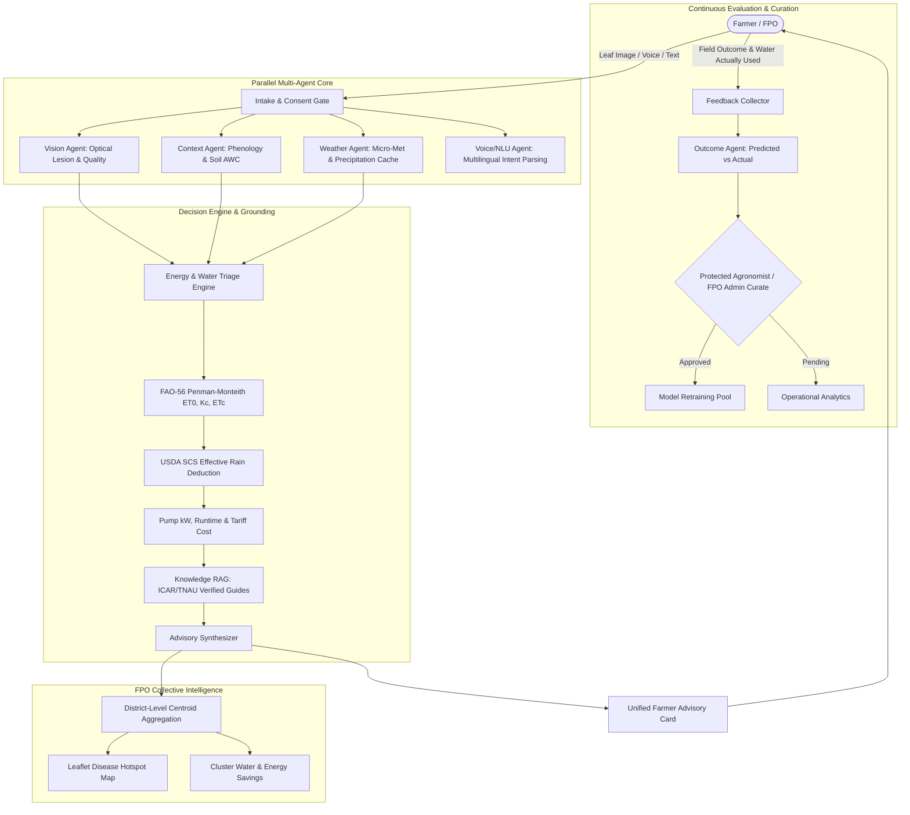

# AgriEdge Architecture Specification

> **Tagline:** Save Water. Save Energy. Grow Smarter.  
> **Core Principle:** Replace expensive physical sensors with software intelligence wherever possible.

---

## 1. System Truth & Capability Matrix: What is Real, Simulated, and Not Built

| Module / Capability | Status | Implementation Details & Behavioral Truth |
| :--- | :--- | :--- |
| **FAO-56 Penman-Monteith Evapotranspiration** | **REAL** | Deterministic agronomic physics engine implementing FAO-56 Equation 6 ($ET_0$), psychrometric parameters, growth-stage coefficients ($K_c$), and crop evapotranspiration ($ET_c$). |
| **Pump Energy & Tariff Model** | **REAL** | Mathematical model calculating pump electrical consumption ($\text{kW} = \text{HP} \times 0.7457$), pumping duration from discharge rate, electrical energy (kWh), electric grid tariff cost, and diesel fuel fallback calculations. |
| **USDA SCS Effective Precipitation** | **REAL** | Deterministic deduction of effective rainfall ($P_e$) from gross irrigation requirements based on precipitation depth. |
| **Leaf Quality Assessment (Blur & Luminance)** | **REAL** | Image preprocessing calculating Laplacian edge variance blur detection, luminance checks, and image dimension validation. |
| **Vision Crop Classification** | **REAL / HEURISTIC FALLBACK** | Multimodal AI classification when vision API key is configured. When unconfigured, employs optical color and aspect-ratio heuristics capped strictly at 0.60 confidence with `requires_agronomist_verification=true` and UI badging. No filename cheats in the production path. |
| **FPO Dashboard & Collective KPIs** | **REAL / DEMO GATED** | Computes KPIs directly from database tables (`FarmerProfile`, `Farm`, `Crop`, `Advisory`, `Feedback`). Zero state returns zeroes with an empty-state message. Seeded demo data is gated behind `DEMO_DATA=true` or `?demo=true` with a clear "Demo data" UI badge. Disease hotspots aggregate strictly to district centroids from actual `Advisory.disease_detected`. |
| **Weather Forecast & Observations** | **REAL / ESTIMATED FALLBACK** | OpenWeatherMap API integration with TTL caching when API key is configured. Transparently falls back to an agro-meteorological estimation model when unconfigured. |
| **APMC Market Pricing** | **REAL / ESTIMATED FALLBACK** | Agmarknet integration when API key is provided. Transparently falls back to regional benchmark price estimates when unconfigured. |
| **Dual-Tier Caching Service** | **REAL** | Dual-tier cache powered by `redis-py` with seamless in-memory TTL dictionary fallback. `/health` inspects and reports the active backend (`redis` vs `memory_fallback`). |
| **Scenario Simulator** | **SIMULATED** | Evaluates what-if agricultural situations using existing FAO-56 and energy models: heatwave stress ($ET_0 +20\%$), 7-day drought ($0\text{ mm}$ rain), power outage (diesel pump fallback), and solar pump conversion (zero electric tariff). |
| **DPDP Digital Consent Gate** | **REAL** | Digital Personal Data Protection compliance: consent capture during registration, timestamped consent version stored on the `User` model, dedicated `/privacy` policy page, and 403 Forbidden enforcement blocking image diagnostics until consent is registered. |
| **Feedback Curation for Retraining** | **REAL** | Length heuristics removed. All feedback records default to `curated_for_retraining=False`. Only set to `True` when approved by an authenticated `AGRONOMIST` or `FPO_ADMIN` via `PATCH /feedback/{id}/curate`. |
| **Supported Languages** | **REAL (en, hi, ta)** | Fully localized UI strings and voice intent parsing for English (`en`), Hindi (`hi`), and Tamil (`ta`). Other languages (`te`, `mr`, `bn`, `kn`) are not built and have been excluded. |
| **WhatsApp / IVR Telephony** | **NOT BUILT** | No telephony, SMS gateway, or WhatsApp Business API integrations are connected. Removed from claims. |
| **NDVI / Satellite Telemetry** | **NOT BUILT** | Foliar diagnostics rely purely on ground-level leaf photographs. No satellite or remote sensing telemetry is implemented. |
| **AWS S3 Cloud Storage** | **NOT BUILT** | Image processing occurs in-memory via Pillow BytesIO and local storage; no AWS S3 buckets are utilized. |
| **MLflow Experiment Tracking** | **NOT BUILT** | Evaluation records are persisted in local SQL database tables; no external MLflow tracking server is configured. |

---

## 2. End-to-End Architectural Flow

---

## 3. Agent Descriptions & Operational Boundaries

| Agent Name | Primary Responsibility | Behavioral Standard & Truth |
| :--- | :--- | :--- |
| **VisionAgent** | Image quality check (Laplacian blur, luminance, min resolution), optical chlorosis/necrosis ratios, foliar disease classification. | When vision AI key is absent, caps heuristic confidence at 0.60 and flags `requires_agronomist_verification=True`. No filename matching. |
| **ContextAgent** | Determines days elapsed since sowing, phenological stage (Seedling, Vegetative, Flowering, Fruiting, Maturity), and soil available water capacity (AWC). | Deterministic crop calendar and soil texture classification. |
| **WeatherAgent** | OpenWeatherMap integration with dual-tier Redis/memory TTL caching (15 min); falls back to agro-met estimation simulator when unconfigured. | Labeled as estimated data when external API key is absent. |
| **RainfallAgent** | Evaluates precipitation probability, intensity, flood/waterlogging hazards, dry spells, and safe irrigation windows. | Deterministic hazard classification based on precipitation volume. |
| **EnergyWaterTriageAgent** | Calculates reference evapotranspiration ($ET_0$), stage coefficient ($K_c$), crop evapotranspiration ($ET_c$), USDA SCS effective rainfall ($P_e$), net and gross irrigation requirements, pump runtime, electrical/diesel consumption, and potential avoided water/energy. | **FAO Irrigation and Drainage Paper 56** standard equations. |
| **KnowledgeAgent (RAG)** | Semantic and keyword retrieval across verified ICAR and TNAU packages of practices with prompt injection sanitization. | Verified agricultural extension publications. |
| **ScenarioAgent** | Simulates what-if scenarios (Heatwave: $ET_0 +20\%$; Drought: 7 days zero rain; Power outage: diesel pump fallback; Solar pump conversion). | Deterministic comparative simulation using existing physics engines. |
| **MarketAgent** | APMC/Agmarknet market intelligence with dual-tier TTL cache; falls back to regional benchmark price estimates when unconfigured. | Labeled as non-live benchmark when external API credentials are absent. |
| **OutcomeAgent** | Compares predicted irrigation actions vs actual field results, calculates adherence and water/energy variance. | Curation for retraining requires explicit agronomist or FPO admin approval via protected endpoint. |

---

## 4. FAO-56 Penman-Monteith Formulation

Reference evapotranspiration ($ET_0$) is calculated in accordance with FAO-56 Equation 6:

$$ET_0 = \frac{0.408 \Delta (R_n - G) + \gamma \frac{900}{T + 273} u_2 (e_s - e_a)}{\Delta + \gamma (1 + 0.34 u_2)}$$

- **Crop Water Consumption:** $ET_c = ET_0 \times K_c$
- **Effective Rainfall ($P_e$):**
  $$P_e = P \times \frac{125 - 0.2 P}{125} \quad (P \le 250\text{ mm})$$
- **Gross Irrigation Requirement:**
  $$IN_g = \frac{\max(0, ET_c - P_e)}{\eta_a}$$
  where $\eta_a = 0.90$ for drip irrigation, $0.75$ for sprinkler, and $0.60$ for flood irrigation.
- **Pumping Power & Energy:**
  $$P_{\text{kW}} = \text{HP} \times 0.7457, \quad \text{Energy (kWh)} = P_{\text{kW}} \times \text{Runtime (hours)}$$
